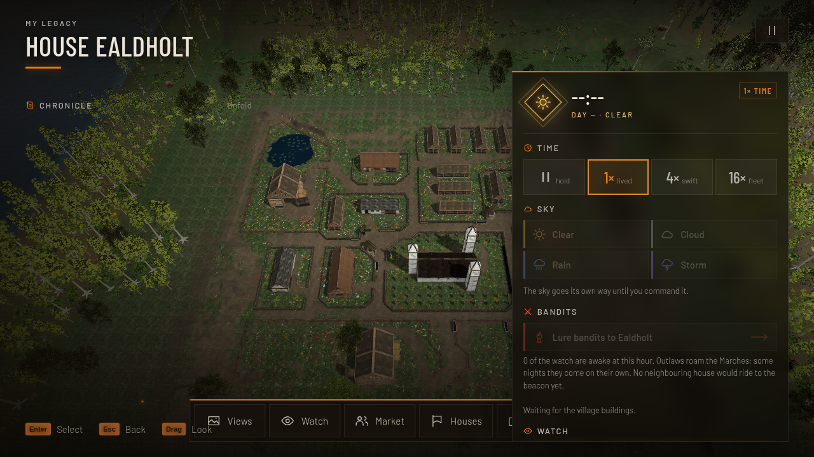
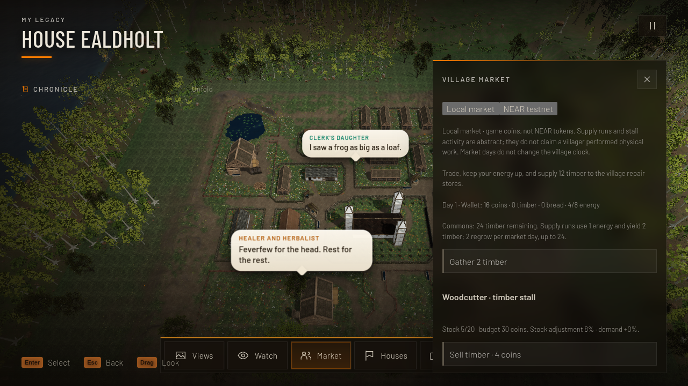
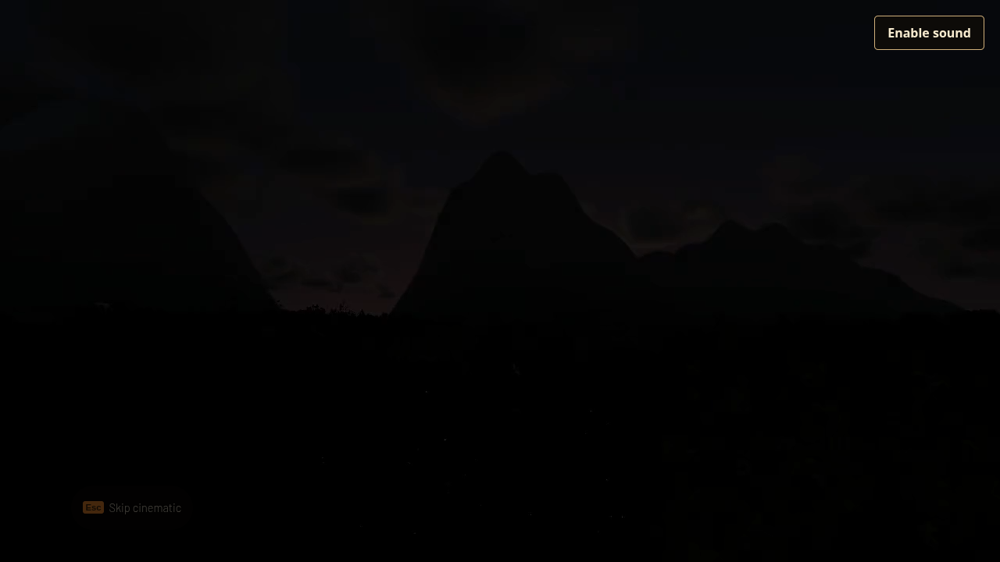
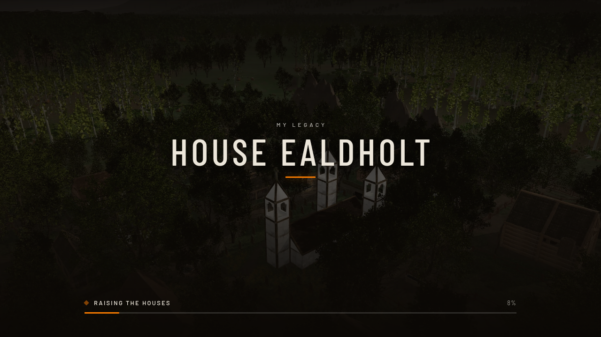

# House Ealdholt

**A living village where the availability and price of essentials can affect what players do.** House Ealdholt brings Crownfall’s existing My Legacy experience into a standalone browser game and adds an economy for the NEAR Hackathon’s **Games With Real Economies** track.

The village is the authored Elderbloom environment, with its existing terrain, waterways, buildings, lighting and resident simulation. The roster contains **100 residents in 25 households**; a smaller, changing selection of character models is rendered at a time.

> **Current status:** The local village market is playable. The NEAR testnet contract and wallet integration are implemented and unit-tested, but the contract is **not deployed** and no Ealdholt wallet transaction has been verified. The public Site is not live. Full 3D setup currently requires authorized access to Crownfall’s private assets.

## Why an economy?

A village cannot repair a damaged building without materials. Ealdholt’s local market turns that need into a player choice: gather or buy timber, trade with merchants that have finite budgets and shelf space, or deliver timber to the actual repair stores. Validated building damage can raise the player’s local timber price; filling the repair stores reduces that pressure. Prices and household demand respond to inventory and money, rather than staying fixed.

The original resident routines, physical navigation, fire and rebuilding systems remain authoritative. A market ledger entry does **not** prove that a villager physically worked, ate, fought a fire or completed a repair.

## The experience


*The authored village. The roster registers 100 residents; not all are rendered simultaneously.*


*The local market uses game credits, not NEAR tokens. This screenshot shows the market before a trade.*

<details>
<summary>Opening film and loading screen</summary>


*The original 30-second film plays on every visit and can be skipped.*


*The original loading screen tracks the village preparation.*

</details>

**Try the local loop:**

1. Open the game, watch or skip the intro, and wait for the village to load. A new local save is created with the Ancestral Oak banner; returning players use their existing browser save.
2. Open **Market** and select **Local market**. Gather two timber. In the verified browser run, timber changed from **0 to 2** and energy from **4 to 3**.
3. Sell timber to the woodcutter, buy bread, or pay to bake it. Stalls can run out of stock, money or room, and quotes change with stock and demand.
4. Deliver **12 timber** to the existing repair stores. A building still needs actual damage, qualified workers, and the original rebuilding conditions before repair work occurs.

The browser verification recorded this actual local interaction:

```text
Before Gather: 16 coins · 0 timber · 0 bread · 4/8 energy
After Gather:  16 coins · 2 timber · 0 bread · 3/8 energy
```

The market also simulates purchases by the 25 existing households. A player may broker a fuel purchase between the baker and woodcutter from the bakery’s own budget. These are ledger events, not claims of physical NPC work. Local market days are advanced by the player and do not advance the village clock.

## Resident conversations

The game includes a conversation integration for all **100 existing resident identities**, using Anthropic **Claude Haiku 5.5** (`claude-haiku-5-5`) with `output_config.effort` set to `low`. Choose **Watch**, follow a resident, and open their conversation panel when the service is configured. Calls are player-initiated: there are no continuous autonomous model loops. The model receives the selected resident’s authored identity, age, role and household context; it does not receive a verified live world state or control movement, work, money or transactions.

**Status:** One live Anthropic response for the existing village smith succeeded through the loopback-only server and its quota guard using `claude-haiku-5-5` and low effort. All 100 resident identities are covered by mocked handler tests. The public AI service is **not deployed**; the panel reports unavailable until its server-side route, verified authentication and durable spending limits are running. The original village simulation continues without it. Never put API keys in this repository or the browser. Player messages and the supplied resident context are sent to the configured AI provider when the service is used.

For a trusted local demo, after building the village, set `ANTHROPIC_API_KEY` in your terminal without saving it in source, then run `NPC_AI_ENABLED=true npm run npc-ai:local` and open the printed loopback URL. The local owner demo defaults to 20 calls per UTC day and must not be exposed through a public proxy. The public quota adapter is designed for **100 calls per day globally and 10 per verified player**, plus rate limits; it still needs a verified Sites identity resolver and deployed D1 database. See [resident AI setup and limits](server/npc-ai/README.md).

## Where NEAR fits

The optional testnet market uses a Rust `near-sdk` contract for a **shared game-credit ledger**. Players connect their own wallet, join, trade with bounded merchant accounts, and list timber or bread in escrow for other players. The contract checks ownership, quantity, price, funds and expiry; it emits structured market events. See [NEAR event format](docs/NEAR-EVENTS.md).

Game credits are internal accounting units—not NEAR, a fungible token, or individual NPC NEAR wallets. Local fire and weather are not trusted as inputs to the shared contract. Applying a finalized, world-bound timber receipt to local repair stores is an explicit player action.

**No Ealdholt testnet contract or transaction is deployed or verified yet.** Do not use another project’s transaction as evidence for this game. The contract is testnet-only prototype code and must not be used for real-value assets. Its fixed 32-player registration limit can be exhausted; the contract owner funds storage. Delivery replay protection is local to the browser save, so restoring an older save can reapply a receipt. Live wallet behavior and gas use remain unverified.

## Run the public tests

These checks do not require the licensed village assets. Use Node.js 20.19 or later, npm, and a current Rust toolchain:

```sh
npm ci
npm run test:market
node --import tsx --test 'main game/src/legacy/aethelgard/observer/near-market-client.test.ts'
npm run test:npc-ai
cargo test --locked --manifest-path contracts/ealdholt-market/Cargo.toml --lib
rustup target add wasm32-unknown-unknown
cargo build --locked --manifest-path contracts/ealdholt-market/Cargo.toml --target wasm32-unknown-unknown --release
```

The Rust and TypeScript suites check pricing, economic turns, budgets, inventory conservation, stale offers and escrow behavior. Node.js 22 or later is required to run the SQLite-backed quota assertions; on Node 20 that portion is skipped. Actual Sites D1 integration remains untested. Structured logs must be verified against a successful, finalized transaction; a log by itself is not settlement proof.

A local NEAR Workspaces sandbox attempt could not start because its required 65,535 file-descriptor limit exceeded this environment’s hard limit of 16,384. These tests do not substitute for a deployed-contract or wallet test.

## Run the actual village

You need Node.js 20.19+, npm, the GitHub CLI, and an account authorized to read the private `mylife-as-miles/Crownfall` repository and its Elderbloom release. Authenticate with `gh auth login` using your own account; never put credentials in this project.

```sh
npm ci
npm --prefix 'main game' ci
mkdir -p private-assets/elderbloom
gh release download elderbloom-village-2026-11-06 --repo mylife-as-miles/Crownfall --dir private-assets/elderbloom --skip-existing
npm run assets:village:verify
npm run assets:house:install
npm run build
npm run preview
```

Open the printed local URL. The install scripts retrieve the exact resident placement, loading image, opening film and soundtrack from private Crownfall and verify the pinned hashes; they will not overwrite a mismatched file. The production build verifies the original film, model, pond probe and population site before it runs. If autoplay blocks sound, use the film’s sound control.

The desktop GLB is 174,285,136 bytes (about 166 MiB), SHA-256 `3b02834505642a5a9e7535e92812df8e565b99005e9921d41be83be4f5da3b28`. The population site is SHA-256 `fc60a1d43098bdb633b696fc92ea4751120f5741e671a699384bf39f7b676475`. The film is 13,820,923 bytes, SHA-256 `cabfcb4780ee7a27675122c9350d257d351e3c7b257da8c18a0d62dfa698fa9e`.

## Preparing a size-limited static host

A normal build serves the verified GLB as one file. For a host with a 25 MiB per-file limit, opt into the chunked loader **when building**, then split that same output:

```sh
VITE_EALDHOLT_CHUNKED_MODEL=1 npm run build
node scripts/split-village-model.mjs \
  --input "$PWD/private-assets/elderbloom/elderbloom-village-desktop-coastal-full-woodland-candidate-v5.glb" \
  --output-dir "$PWD/main game/dist/legacy/elderbloom" --remove-model-copy
npm run test:chunks
```

The script produces 11 chunks of at most 16 MiB and verifies their reassembled SHA-256. It removes only the separately verified copy in the build output, not the source asset. The browser reconstructs the original bytes and verifies their hash before rendering; HTTPS or localhost is required for WebCrypto. This prepared build has not yet been deployed to Sites or tested on target devices.

## What was verified

- The production build and focused population, building-disaster, market, keyboard and film tests passed.
- In a fresh headless browser, the actual film played before the village mounted. Skip opened the loading screen; reloading presented the film again.
- The actual model and population loaded, with 100 residents registered and three resident draw calls reported in the observed frame. Opening Market and gathering timber changed the displayed wallet from 0 to 2 timber and energy from 4 to 3. No page errors or failed local asset requests were reported in that run.
- The real desktop GLB was split into 11 parts and reassembled through the chunk loader to its pinned SHA-256. The chunk-enabled build has not yet been verified in a browser or on Sites.
- The existing building-disaster source tests include a deterministic burn-to-rebuild fixture. A complete physical fire-and-rebuild sequence has not been visually verified in this standalone. Device performance, gamepad routing, a public Site, a deployed Ealdholt contract and a live NEAR transaction are also unverified.

## New work and provenance

The Crownfall baseline for this standalone is [`8537296`](https://github.com/mylife-as-miles/House-Ealdholt/commit/8537296096c51f3eacdb56be09e847909f666376). The NEAR Hackathon additions are on [`hackathon/near-village-economy`](https://github.com/mylife-as-miles/House-Ealdholt/tree/hackathon/near-village-economy); [review the diff](https://github.com/mylife-as-miles/House-Ealdholt/compare/8537296096c51f3eacdb56be09e847909f666376...hackathon/near-village-economy). They include the market, contract, wallet integration, pricing, escrow, tests and documentation. The village, residents and inherited simulation predate this work.

The source combines Crownfall’s `codex/ealdholt-open-water-procedural-fire` at `54aa7b1dd50eb777b01caf75cbcbdd98af4e3aef`, including building-disaster PR #14, with later `main` work at `a8e9d8013eef0d24c7166f7a845d5cd2248d650b`. The original Crownfall checkout remains separate.

## Licences and credits

Crownfall code retains its [MIT licence](LICENSE). Market pricing adapts Apache-2.0 [Copper Acorn](https://github.com/san-npm/copper-acorn); the applicable [licence and notice](third_party/copper-acorn) are retained. See [economy research](docs/ECONOMY-RESEARCH.md) for the other sources and design references.

Elderbloom remains subject to its Fab Standard License and NoAI restrictions; the GLB, reflection, site file, opening film and soundtrack are not relicensed by this repository’s code licence. The project owner confirmed permission for public browser delivery of the GLB and for the two intro camera moves credited to Leonxlnx’s [FIRST BLOOM](https://github.com/Leonxlnx/first-bloom), whose repository states no code licence. This project-specific confirmation is not a general reuse licence. The intro soundtrack was generated using Stable Audio 3.0 Small under its community licence. The `dist` output contains the licensed assets: distribute it only under applicable terms.

The 100STYLE-derived motion clips are CC BY 4.0, credited to Ian Mason, Sebastian Starke and Taku Komura. MakeHuman and Poly Haven sources include CC0 material; their provenance and notices remain with the assets. Fonts retain their SIL Open Font License notices. Screenshots in this README are captures of the game and do not grant a licence to extract or reuse its assets.
